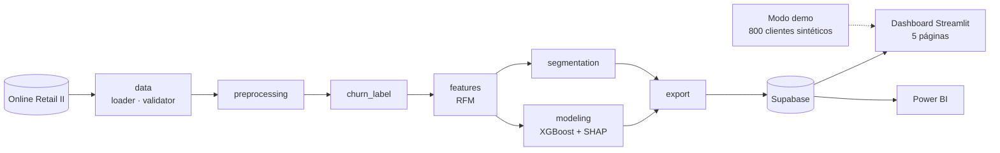

<p align="center"></p>

<h1 align="center">Churn Intelligence</h1>

<p align="center"><b>From purchase behavior to risk segments and retention scenarios.</b></p>

<p align="center"><a href="https://churnmodel2026.streamlit.app/"><b>Live demo ↗</b></a></p>

<p align="center"></p>

<p align="center">
     
</p>

<p align="center"><a href="https://dodysalim.github.io/"><b>🌐 Portfolio</b></a> · <a href="https://nocountry.tech/showcase/simulacion-laboral-marzo-2026/equipo-40-data-science"><b>🏆 No Country Showcase</b></a> · <a href="README.md"><b>🇪🇸 Versión en español</b></a></p>

---

## 📌 At a glance

| | |
| --- | --- |
| **🎯 Problem** | Detect e-commerce customers showing churn signals and the value at risk. |
| **🛠️ Solution** | RFM segmentation, churn labeling and XGBoost with SHAP, plus training/inference pipelines. |
| **📈 Deliverables** | 5-page Streamlit dashboard (demo mode without credentials) and Power BI. |
| **🧪 Quality** | 25 automated tests. |
| **👤 My role** | Data Analyst in a 4-person team. |

## 🏗️ Architecture



## 🚀 How to run

```bash
pip install -r requirements.txt -r requirements-dev.txt
python -m streamlit run Dashboard/webapp/app.py
python -m pytest tests -q
```

## ⚖️ Scope

Demo data, illustrative trends and scenario ROI are not observed results.

## 👥 Team

Team: Lucel · Junior Alexis · Geyson David · Dody (Data Analyst). Collective authorship is preserved.

---

<p align="center">
<b>Dody Dueñas Remache</b> · Data Analyst / Data Scientist · Guayaquil, Ecuador (remote LATAM)<br>
<a href="https://dodysalim.github.io/">Portfolio</a> · <a href="https://github.com/dodysalim">GitHub</a> · <a href="https://www.linkedin.com/in/dody-duenas/">LinkedIn</a> · <a href="mailto:dodydurema67@gmail.com">dodydurema67@gmail.com</a>
</p>
