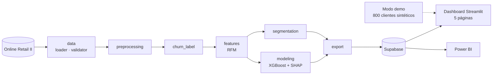

<p align="center"></p>

<h1 align="center">Churn Intelligence</h1>

<p align="center"><b>Del comportamiento de compra a segmentos de riesgo y escenarios de retención.</b></p>

<p align="center">

</p>

<p align="center">
     
</p>

<p align="center">
<a href="https://github.com/dodysalim/-E-commerce-Churn-Model-S03-26-Equipo-40-Data-Science/actions"></a> 
</p>

<p align="center"><a href="https://nocountry.tech/showcase/simulacion-laboral-marzo-2026/equipo-40-data-science"><b>🏆 Showcase No Country</b></a> · <a href="https://dodysalim.github.io/"><b>🌐 Portafolio</b></a> · <a href="docs/PORTFOLIO_CASE.md"><b>📄 Caso de estudio</b></a> · <a href="README.en.md"><b>🇺🇸 English</b></a></p>

---

## 📌 Resumen en 30 segundos

| | |
| --- | --- |
| **🎯 Problema** | Detectar clientes de e-commerce con señales de abandono y el valor que está en riesgo. |
| **🛠️ Solución** | Segmentación RFM, etiquetado de churn y modelo XGBoost, con pipelines de entrenamiento e inferencia. |
| **📈 Entregables** | Dashboard Streamlit de 5 vistas (modo demo sin credenciales) y Power BI para PC y móvil. |
| **🧪 Calidad** | 25 pruebas automatizadas aprobadas. |
| **👤 Mi rol** | Data Analyst en equipo multidisciplinario de 4 personas. |

## ❓ La pregunta de negocio

¿Qué clientes muestran señales de abandono y qué segmentos concentran el valor expuesto?

## ✨ Qué incluye

- Preprocesamiento de transacciones, RFM y etiquetado de churn.
- Pipelines de entrenamiento, evaluación y exportación.
- Dashboard de cinco vistas, con demostración sintética identificada.

## 🏗️ Arquitectura



## 🚀 Cómo ejecutarlo

Usa Python 3.11 o 3.12 en un entorno independiente. Desde la raíz:

```bash
python -m venv .venv
# Windows: .venv\Scripts\activate
# macOS/Linux: source .venv/bin/activate
python -m pip install -r requirements.txt
python -m pip install -r requirements-dev.txt
```

Después de configurar los datos:

```bash
python -m streamlit run Dashboard/webapp/app.py
```

## ☁️ Publicar el dashboard gratis

[](https://share.streamlit.io/deploy?repository=dodysalim/-E-commerce-Churn-Model-S03-26-Equipo-40-Data-Science&branch=main&mainModule=Dashboard/webapp/app.py)

Un clic abre Streamlit Community Cloud con este repositorio y `Dashboard/webapp/app.py` preconfigurados (dependencias: `requirements.txt`). Funciona sin credenciales: modo demo con 800 clientes sintéticos.

## 🗂️ Datos y configuración

La demostración funciona sin Supabase con 800 clientes sintéticos. Para usar las vistas reales, configura SUPABASE_URL y SUPABASE_KEY (anon, solo lectura con RLS) para el dashboard, y SUPABASE_SERVICE_KEY (secreta) para el pipeline que escribe. Los importes conservan las unidades de origen.

## 📊 Power BI · PC y móvil

[Archivos e instrucciones](powerbi/README.md). Descarga el repositorio completo y abre `powerbi/Abrir-PowerBI.bat` en Windows; después pulsa **Actualizar**. Incluye A4 horizontal a tamaño real (100 %) y diseño móvil vertical. El archivo `.pbip` necesita sus carpetas Report, SemanticModel y data.

## 🧭 Estructura del repositorio

| Ruta | Qué contiene |
| --- | --- |
| [src/](src/) | Limpieza, características, modelos y segmentación |
| [pipelines/](pipelines/) | Entrenamiento, inferencia y exportación |
| [Dashboard/webapp/](Dashboard/webapp/) | Interfaz Streamlit |
| [sql/](sql/) | Esquema y vistas de Supabase |
| [tests/](tests/) | Pruebas unitarias |

## ✅ Calidad y alcance

25 pruebas aprobadas, incluidas cinco regresiones de datos del dashboard. Inicio y las cinco páginas de análisis probados en modo demo sin excepciones (26-10-2026).

Los datos demo, tendencias ilustrativas y ROI de escenarios no son resultados observados. No se repitió el entrenamiento sobre Online Retail II ni se comprobó Supabase en vivo.

Para repetir las pruebas desde la raíz:

```bash
python -m pytest tests -q
```

## 👥 Autoría

Simulación No Country, Sprint 3, Equipo 40. Se mantiene la atribución colectiva y la documentación original.


### Equipo · Marzo 2026

| Integrante | Rol publicado |
| --- | --- |
| Lucel | Data |
| Junior Alexis | Data Scientist |
| Geyson David | Data Scientist |
| Dody | Data analyst |

Créditos basados en el [showcase oficial](https://nocountry.tech/showcase/simulacion-laboral-marzo-2026/equipo-40-data-science). Se conserva la autoría colectiva.

[Documentación anterior](docs/ORIGINAL_README.md), conservada como referencia histórica.

---

<p align="center">
<b>Dody Dueñas Remache</b> · Analista de Datos / Data Scientist<br>
<a href="https://dodysalim.github.io/">Portafolio</a> · <a href="https://github.com/dodysalim">GitHub</a> · <a href="https://www.linkedin.com/in/dody-duenas/">LinkedIn</a> · <a href="mailto:dodydurema67@gmail.com">dodydurema67@gmail.com</a>
</p>
